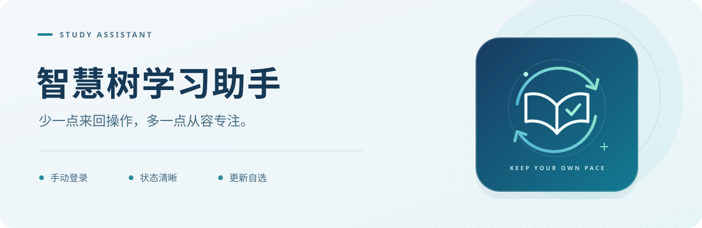

<p align="center">
  
</p>

<p align="center">
  <a href="https://github.com/JLKin/Study--Assistant/releases/latest"></a>
  
  
</p>

<p align="center">
  <a href="https://github.com/JLKin/Study--Assistant/releases/latest"><b>下载正式版</b></a>
  &nbsp; · &nbsp;
  <a href="#开始使用">开始使用</a>
  &nbsp; · &nbsp;
  <a href="#常见问题">常见问题</a>
  &nbsp; · &nbsp;
  <a href="https://github.com/JLKin/Study--Assistant/issues">反馈建议</a>
</p>

<br />

学习的时间，应该更多留给内容本身。

**智慧树学习助手**是一款 Windows 桌面学习辅助工具，将播放状态、章节切换、课程队列和常用设置收进一个清晰的界面。你在专用浏览器里完成登录，助手照看已适配的播放流程；进度与提示随时可见，需要时也能停下来，按自己的节奏继续。

## 把重复操作，安排得更妥帖

| 你关心的事   | 助手如何配合                                                           |
| :----------- | :--------------------------------------------------------------------- |
| **手动登录** | 默认手动登录，在专用 Edge 窗口中完成；与日常浏览器使用独立的配置目录。 |
| **进度可见** | 查看当前课程、视频进度和运行提示，按设定阈值衔接已适配章节。           |
| **课程队列** | 可指定课程名称，也可留空处理课程队列；支持停止与断点记录。             |
| **灵活设置** | 切章阈值、等待时间、异常停止与提醒等，都可以在设置中调整。             |
| **自主更新** | 手动检查、下载并确认使用新版；公告保留历史，离线时可查看缓存内容。     |

以上介绍以正式版程序为准。共享课与智慧课程的已适配页面均有支持；平台布局变化或课程差异，可能需要进一步适配。

## 下载，选一种适合你的方式

目前可下载的正式版为 **v0.5.1**。普通使用者无需安装 Node.js 或 Python，准备好 **Windows 10 / 11 64 位系统与 Microsoft Edge** 即可。

这一版重点改善登录与启动稳定性：减少登录跳转被打断的情况，收敛黑屏恢复流程；界面无法恢复时，会显示日志位置与处理建议。

| 版本                    | 适合怎样使用                                         | 下载                                                                                                                            |
| :---------------------- | :--------------------------------------------------- | :------------------------------------------------------------------------------------------------------------------------------ |
| **安装版 · Setup**      | 希望通过安装向导设置位置，并保留快捷方式和卸载入口。 | [下载安装包](https://github.com/JLKin/Study--Assistant/releases/download/v0.5.1/ZHS-Study-Assistant-0.5.1-win-x64-Setup.exe)    |
| **免安装版 · Portable** | 希望解压即用，方便自行管理程序目录。                 | [下载压缩包](https://github.com/JLKin/Study--Assistant/releases/download/v0.5.1/ZHS-Study-Assistant-0.5.1-win-x64-Portable.zip) |

[查看最新发布与全部附件 →](https://github.com/JLKin/Study--Assistant/releases/latest)

免安装版请**完整解压**后运行 `智慧树学习助手.exe`，并保留同目录的资源文件。两个程序包均未做代码签名，Windows 可能显示“已发布者未知”。

## 开始使用

1. **打开助手。** 安装或解压后启动程序，阅读并确认首次使用声明。
2. **选好课程。** 在“刷课”页填写课程名称；留空时按课程队列运行。
3. **完成登录。** 点击“开始刷课”，在弹出的专用 Edge 窗口中手动登录。
4. **查看运行状态。** 登录后观察课程、进度与日志提示；需要调整时进入“设置”，或点击停止。

遇到需要人工处理的验证或页面提示，请回到浏览器按提示完成。平台是否记录学习完成，请以官方课程页面为准。

## 数据留在熟悉的位置

正式版的配置、运行日志与专用浏览器资料保存在本机：

```text
%APPDATA%\智慧树学习助手\data
```

安装版与免安装版使用同一个数据位置。更换程序目录前，可以先退出助手并备份该目录；卸载程序与清除个人数据是两件独立的事。

反馈问题时，一段清晰的复现过程通常最有帮助：**软件版本、Windows / Edge 版本、操作步骤，以及脱敏后的错误提示**。请移除截图中的姓名、账号和身份参数，并保留浏览器会话、Cookie 与登录资料的私密性。

## 常见问题

<details>
<summary><b>需要把账号密码交给助手吗？</b></summary>

默认不需要。在专用 Edge 中自行登录即可，手动模式不会读取保存的密码。如需使用可选的账号密码登录，请在应用中主动切换。

</details>

<details>
<summary><b>弹题、章节测试和考试会怎样处理？</b></summary>

已适配的播放弹题会尝试选择、确认并关闭，带计分提示的弹题也会处理。随机选择不保证正确率，可能影响课程得分。独立的章节测试和正式考试页面尚未接入默认桌面流程。

</details>

<details>
<summary><b>倍速和验证码可以自动完成吗？</b></summary>

倍速请在网页中手动设置。不同验证方式的处理能力有限，遇到程序无法完成的验证时，需要在浏览器中人工处理。

</details>

<details>
<summary><b>更新会强制安装吗？</b></summary>

正式版使用本仓库的 GitHub Releases 作为更新源，只接受更高版本的正式发布，忽略草稿与预发布。下载后由你确认使用，不会在后台强制安装。

真实跨版本覆盖安装与免安装版切换仍有待补齐实机验收，更新前请保留必要的数据备份。

</details>

<details>
<summary><b>想从源码运行，应该从哪里开始？</b></summary>

当前公开主分支保留的是较早源码快照，与 v0.5.1 程序包不完全对应。需要直接使用时，请优先下载 Releases 中的程序包。

开发环境为 Windows、Node.js 24、npm 与 Microsoft Edge：

```powershell
npm.cmd ci
npm.cmd run setup:electron
npm.cmd start
```

类型检查、测试与构建：

```powershell
npm.cmd run typecheck
npm.cmd test
npm.cmd run build
```

测试包含本地浏览器集成场景，需要 Edge；本地测试通过不代表真实课程流程已完成验收。

</details>

## 一起让它更好用

欢迎在 [Issues](https://github.com/JLKin/Study--Assistant/issues) 留下问题与建议。描述遇到了什么、期待怎样的体验，会让后续改进更有方向。

本项目与智慧树官方无隶属关系，请在本人有权访问的课程中合理使用。源码公开不等于已授予开源许可证；第三方组件遵循各自许可，见 [第三方组件说明](THIRD_PARTY_NOTICES.md)。

<br />

<p align="center"><sub>少一点来回操作，多一点从容专注。</sub></p>
